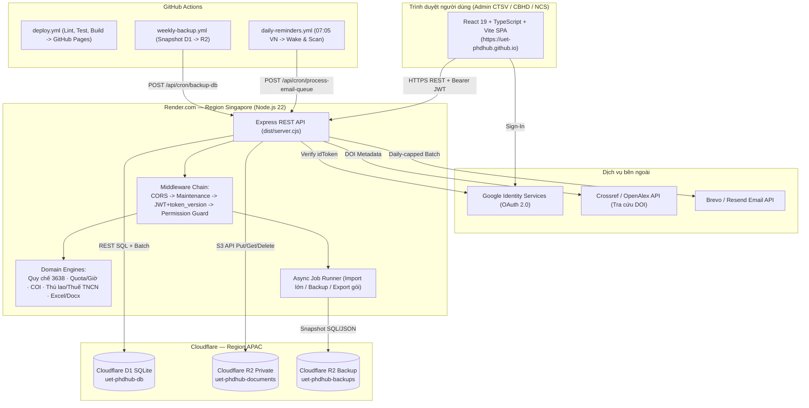
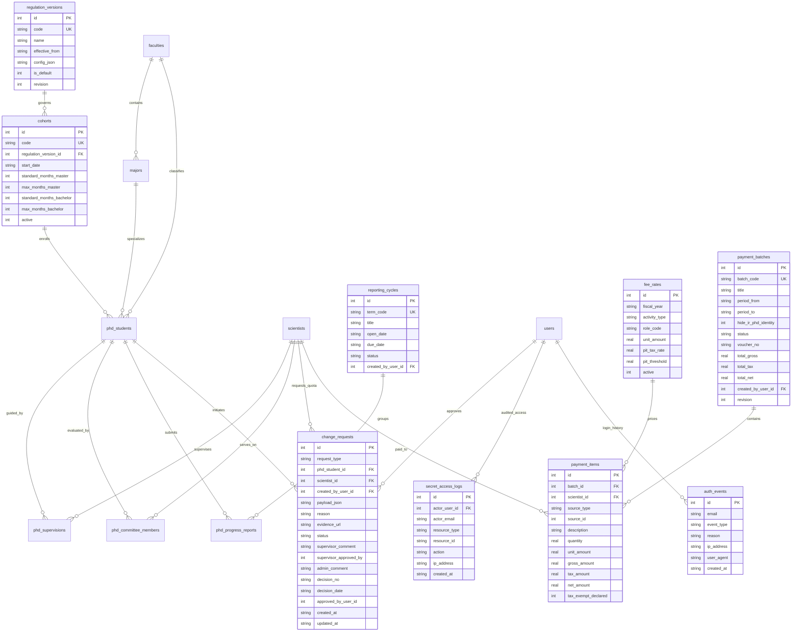
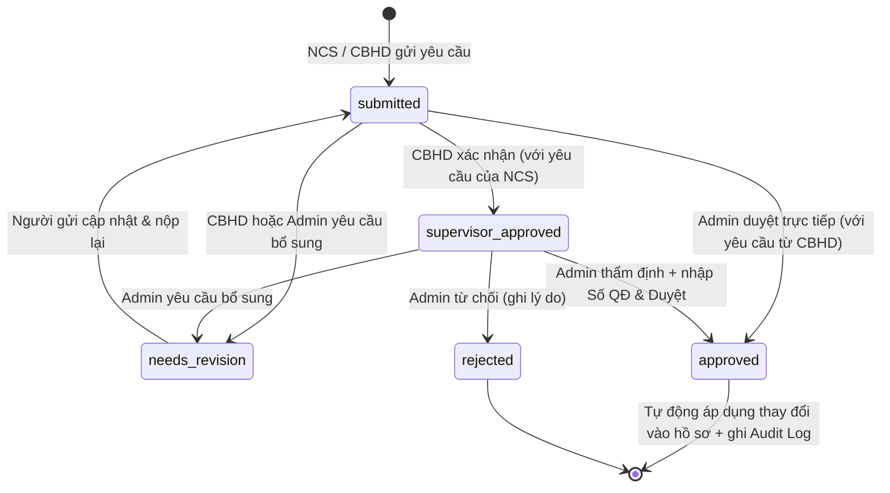
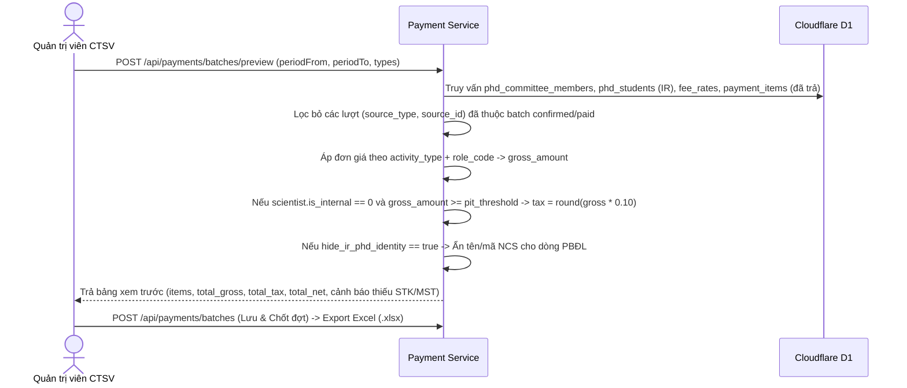

# TÀI LIỆU THIẾT KẾ HỆ THỐNG (SDS)
## Hệ thống Quản lý Nghiên cứu sinh — UET PhDHub
**Phiên bản tài liệu:** 2.0 (Đồng bộ với `SRS_Tai_lieu_Yeu_cau_UET_PhDHub.md` v2.0)  
**Hạ tầng vận hành thực tế:** GitHub Pages (`https://uet-phdhub.github.io`) · Render.com Singapore (`https://uet-phdhub-api.onrender.com`) · Cloudflare D1 (`uet-phdhub-db`, APAC) · Cloudflare R2 (`uet-phdhub-documents`, APAC)  

---

## 1. Kiến trúc Tổng thể Hệ thống

### 1.1. Sơ đồ Kiến trúc Triển khai (Deployment Architecture)

### 1.2. Lý do chọn Kiến trúc Lai (GitHub Pages + Render + Cloudflare D1/R2)
- **Render.com (Node.js/Express)** xử lý an toàn các tác vụ nặng CPU/RAM (SheetJS đọc/ghi Excel 58+ cột, sinh `.docx`/`.pdf`, nén snapshot backup, đẩy file 15MB lên R2, xả batch email) mà không bị giới hạn 10ms CPU của Cloudflare Workers Free.
- **Cloudflare D1 (APAC) + Cloudflare R2 (APAC)** đặt cùng vùng châu Á với **Render Singapore**, đảm bảo độ trễ thấp, không mất dữ liệu khi container Render khởi động lại (stateless server).
- **Frontend tĩnh trên GitHub Pages** tải cực nhanh qua CDN toàn cầu, tự động CI/CD qua `deploy.yml` kèm cổng kiểm thử `tsc --noEmit` + `npm test`.

---

## 2. Thiết kế Phân quyền, Xác thực & Bảo mật

### 2.1. Kiến trúc Phân quyền theo `permission_code`
Dù giai đoạn hiện tại hợp nhất **Chuyên viên Phòng CTSV = Quản trị viên (`admin`)**, tầng Backend vẫn kiểm tra quyền dựa trên danh sách `permissions` ánh xạ từ bảng `roles` để mở rộng không phá vỡ code cũ:

| Permission Code | Mô tả quyền | `admin` | `supervisor` | `phd_student` | Dự phòng tương lai |
| --- | --- | :---: | :---: | :---: | --- |
| `phd:read_all` / `phd:write_all` | Đọc & ghi toàn bộ hồ sơ NCS toàn Trường | ✅ | — | — | `staff` |
| `phd:read_own` | Đọc hồ sơ NCS của bản thân hoặc NCS đang hướng dẫn | ✅ | ✅ | ✅ | `faculty_coordinator` |
| `ir:manage` | Xem, sửa, xuất Excel & tệp **Phản biện độc lập (Mật)** | ✅ | ❌ | ❌ | `ir_officer` |
| `scientist:manage` | Quản trị 4 danh sách Cán bộ & xác minh điểm 3638 | ✅ | — | — | `staff` |
| `scientist:read_financial` | Xem & xuất thông tin CCCD, MST TNCN, Số tài khoản | ✅ | Chỉ bản thân | ❌ | `accountant` |
| `request:create` | Tạo yêu cầu điện tử (gia hạn, đổi đề tài, tăng Quota) | ✅ | ✅ | ✅ | — |
| `request:supervisor_review` | Xác nhận chuyên môn đối với yêu cầu & báo cáo tiến độ NCS | ✅ | ✅ | ❌ | — |
| `request:approve` | Phê duyệt cuối cùng yêu cầu điện tử & áp dụng vào hồ sơ | ✅ | ❌ | ❌ | `leader` |
| `payment:manage` | Cấu hình đơn giá, tính thù lao & thuế TNCN, xuất bảng kê | ✅ | ❌ | ❌ | `accountant` |
| `system:manage` | Cấu hình Quy chế, Danh mục, Tài khoản, Mẫu Email, Backup, Bảo trì | ✅ | ❌ | ❌ | `super_admin` |

### 2.2. Thiết kế Bảo mật Tầng Ứng dụng
1. **Xác thực & Thu hồi phiên tức thì (`token_version`)**:
   - Payload JWT gồm `{ uid, email, role, scientist_id, phd_student_id, tv }`.
   - Middleware `authenticateToken` kiểm tra chữ ký JWT và đối chiếu `tv` với `users.token_version` (có cache LRU 30 giây trong RAM, xóa cache ngay khi Admin sửa/khóa tài khoản).
   - Khi Admin bấm *Khóa tài khoản* hoặc *Đăng xuất mọi thiết bị*, hệ thống tăng `token_version = token_version + 1` → mọi token cũ lập tức nhận `401 Unauthorized`.
2. **Bảo vệ Dữ liệu Mật (Defense-in-Depth)**:
   - **Tầng API**: Bộ lọc `stripConfidentialFields(row)` luôn chạy ở mọi endpoint trả về NCS/Cán bộ nếu người gọi không có `ir:manage` hoặc `scientist:read_financial`.
   - **Tầng UI + Audit**: Các trường `cccd`, `tax_code`, `bank_account` mặc định trả thêm bản che ký tự; khi bấm *Xem đầy đủ / Sao chép* hoặc *Xuất Excel PBĐL / Thanh toán*, gọi endpoint ghi nhận vào `secret_access_logs`.
   - **Tầng Lưu trữ (R2)**: Không bật Public Access trên `uet-phdhub-documents`. Mọi tệp tải xuống đi qua `GET /api/documents/:id/download` (kiểm tra JWT + quyền truy cập `phd_student_id` + cờ `is_confidential`).
3. **Chống Ghi đè Đồng thời (Optimistic Locking)**:
   - Mọi thao tác `PUT` trên `phd_students`, `scientists`, `regulation_versions`, `payment_batches` gửi kèm `expectedRevision`. Nếu `revision` trong DB đã thay đổi, API trả về `409 Conflict` kèm thông báo tải lại bản mới nhất.

---

## 3. Thiết kế Cơ sở dữ liệu (Cloudflare D1 / SQLite)

### 3.1. Tổng quan Bảng dữ liệu
- **15 bảng lõi hiện có (v1)**: `faculties`, `majors`, `scientists`, `phd_students`, `users`, `phd_supervisions`, `phd_committee_members`, `scientist_publications`, `phd_publications`, `phd_progress_reports`, `documents`, `notifications`, `settings`, `import_previews`, `audit_logs`.
- **10 bảng mở rộng cho v2**: `roles`, `regulation_versions`, `cohorts`, `reporting_cycles`, `change_requests`, `fee_rates`, `payment_batches`, `payment_items`, `email_templates`, `secret_access_logs` (cùng `background_jobs` & `auth_events` cho vận hành).

### 3.2. Sơ đồ Thực thể Quan hệ (ER Diagram — Bảng lõi & Bảng mở rộng v2)

### 3.3. Thay đổi Cột bổ sung trên Bảng Hiện có (Migration An toàn)
- Bảng `users`: thêm `token_version INTEGER NOT NULL DEFAULT 1`, `expires_at TEXT`, `last_login_at TEXT`.
- Bảng `phd_students`: thêm `cohort_id INTEGER REFERENCES cohorts(id)`, `regulation_version_id INTEGER REFERENCES regulation_versions(id)`.
- Bảng `phd_progress_reports`: thêm `cycle_id INTEGER REFERENCES reporting_cycles(id)`.
- Bảng `scientists`: thêm `revision INTEGER NOT NULL DEFAULT 1`.
- Ràng buộc chống thanh toán trùng trên `payment_items`: `UNIQUE(source_type, source_id)` cho các dòng thuộc đợt có trạng thái `confirmed` hoặc `paid` (hoặc kiểm tra transaction khi chốt đợt).

---

## 4. Thiết kế Luồng Nghiệp vụ Trọng tâm (Workflows & Algorithms)

### 4.1. Máy trạng thái & Luồng Phê duyệt Điện tử (`change_requests`)

**Hiệu ứng tự động (Atomic Side-Effects) khi `admin` bấm Phê duyệt:**
1. **`extension` (Gia hạn) / `deferral` (Bảo lưu)**:
   - Kiểm tra `new_standard_deadline <= max_deadline` (cảnh báo nếu vượt).
   - Cập nhật `phd_students.standard_deadline`, `study_status` (`extended` / `deferred`), nối bản ghi mới vào `training_changes_json`, gửi thông báo cho NCS & CBHD.
2. **`topic_change` (Điều chỉnh tên đề tài)**:
   - Cập nhật `adjusted_dissertation_title`, `title_change_decision_no`, ghi `training_changes_json`.
3. **`supervisor_change` (Thay đổi CBHD)**:
   - Gọi `calculateSupervisorQuotaAndHours()` kiểm tra định mức CBHD mới trước khi xác nhận.
   - Cập nhật `phd_supervisions`, ghi `training_changes_json`, gửi thông báo cho cả CBHD cũ & mới.
4. **`special_quota` (Đề nghị tăng định mức CBHD trình GĐ ĐHQGHN)**:
   - Cập nhật `scientists.special_quota_approved = 1`, `special_quota_limit`, `special_quota_decision`, `special_quota_reason`, gửi thông báo cho CBHD.

### 4.2. Thuật toán Kiểm tra Xung đột lợi ích (COI Engine — `shared/coi.ts`)
Đầu vào: `(phdStudentId, candidateScientistId, targetRole: 'seminar' | 'independent_reviewer' | 'defense_council', memberRole?)`:
1. **Quy tắc 1 (Chặn cứng — Error)**: Nếu `candidateScientistId` đang là CBHD (`phd_supervisions`) của `phdStudentId` và `targetRole === 'independent_reviewer'` → **Chặn**, không cho gán làm PBĐL.
2. **Quy tắc 2 (Cảnh báo nặng — Warning)**: Nếu `candidateScientistId` là CBHD của `phdStudentId` khi lập HĐ Đánh giá LATS mà vai trò không phải Ủy viên/Thư ký theo quy định → **Cảnh báo**.
3. **Quy tắc 3 (Cảnh báo — Warning)**: Nếu tên hoặc email `candidateScientistId` xuất hiện trong `phd_students.ir_declined_info` → **Cảnh báo đã từng từ chối**.
4. **Quy tắc 4 (Chuẩn 3638 — Warning)**: Đối chiếu `evaluateScientistResearchCapacity()` với ngưỡng `seminarMinPoints` / `reviewerMinPoints` / `councilMinPoints` của phiên bản Quy chế áp dụng → báo rõ thiếu bao nhiêu điểm.
5. **Quy tắc 5 (Cơ cấu Hội đồng — Summary Check)**: Khi lưu danh sách thành viên HĐ Đánh giá LATS, kiểm tra tổng số thành viên (mặc định 7) và số thành viên `is_internal = 0` (ngoài cơ sở đào tạo, tối thiểu theo cấu hình Quy chế).

### 4.3. Thuật toán Tính Thù lao & Khấu trừ Thuế TNCN (`server/services/payments.ts`)

- **Kiểm tra dữ liệu kế toán trước khi xuất**: tự động đánh dấu cảnh báo những dòng Cán bộ còn thiếu `CCCD`, `MST TNCN` hoặc `Số tài khoản / Ngân hàng` để Chuyên viên bổ sung trước khi nộp Phòng Kế hoạch – Tài chính.

---

## 5. Thiết kế API RESTful Mở rộng (v2 Endpoints)

*(Giữ nguyên toàn bộ API v1 tại `/api/auth`, `/api/dashboard`, `/api/phd-students`, `/api/scientists`, `/api/documents`, `/api/excel`, `/api/notifications`, `/api/settings`)*

| Nhóm | Method & Path | Quyền yêu cầu | Mô tả |
| --- | --- | --- | --- |
| **Phê duyệt điện tử** | `GET /api/requests` | `request:create` | Danh sách yêu cầu (Admin thấy toàn Trường; CBHD thấy của mình + NCS hướng dẫn; NCS thấy của mình) |
| | `POST /api/requests` | `request:create` | Tạo yêu cầu gia hạn / bảo lưu / đổi đề tài / đổi CBHD / tăng Quota |
| | `PUT /api/requests/:id/supervisor-review` | `request:supervisor_review` | CBHD xác nhận hoặc yêu cầu NCS bổ sung |
| | `PUT /api/requests/:id/decision` | `request:approve` | Admin phê duyệt (+ Số QĐ, tự áp dụng side-effect) hoặc từ chối |
| **Kỳ báo cáo tiến độ** | `GET/POST/PUT /api/reporting-cycles` | `phd:write_all` | Tạo & quản lý đợt báo cáo tiến độ theo học kỳ |
| | `GET /api/reporting-cycles/:id/summary` | `phd:read_all` | Thống kê tỷ lệ nộp/duyệt & danh sách chưa nộp |
| | `POST /api/reporting-cycles/:id/remind` | `phd:write_all` | Gửi nhắc hàng loạt tới NCS chưa nộp & CBHD chưa duyệt |
| **COI & DOI** | `POST /api/check/coi` | `phd:write_all` | Kiểm tra xung đột lợi ích + điểm 3638 + cơ cấu hội đồng |
| | `GET /api/publications/lookup-doi?doi=...` | Đã đăng nhập | Tra cứu metadata bài báo qua Crossref / OpenAlex |
| **Thù lao & Thanh toán** | `GET/PUT /api/settings/fee-rates` | `payment:manage` | Cấu hình bảng đơn giá thù lao & quy tắc thuế TNCN 10% |
| | `POST /api/payments/batches/preview` | `payment:manage` | Xem trước bảng kê tổng hợp theo khoảng thời gian (chống trùng) |
| | `GET/POST/PUT /api/payments/batches` | `payment:manage` | Lưu, chỉnh sửa miễn thuế 08/CK-TNCN, chốt & đánh dấu đã chi |
| | `GET /api/payments/batches/:id/export` | `payment:manage` | Xuất Excel bảng kê thanh toán (ghi `secret_access_logs`) |
| **Biểu mẫu Word/PDF** | `GET /api/forms/phd/:id/:templateCode` | `phd:read_all` | Sinh biểu mẫu `.docx` (Phiếu 3638, Tờ trình HĐ, Giấy mời PBĐL) |
| **Quản trị Hệ thống** | `GET/POST/PUT /api/settings/regulation-versions` | `system:manage` | Quản lý phiên bản Quy chế & xem trước tác động |
| | `GET/POST/PUT /api/settings/cohorts` | `system:manage` | Quản lý Khóa/Đợt tuyển sinh & thời hạn chuẩn/tối đa mặc định |
| | `GET/PUT /api/settings/email-templates` | `system:manage` | Chỉnh mẫu email động & gửi thử nghiệm |
| | `POST /api/settings/users/:id/revoke-sessions` | `system:manage` | Tăng `token_version` thu hồi phiên đăng nhập tức thì |
| | `GET /api/settings/audit-logs` & `/secret-access-logs` | `system:manage` | Tra cứu nhật ký kiểm toán (lọc + diff) & truy cập dữ liệu mật |
| | `GET/POST /api/system/backups` & `GET /api/system/health` | `system:manage` | Tạo/tải snapshot D1 → R2, quét tệp mồ côi R2, bật/tắt Bảo trì |
| | `POST /api/cron/backup-db` | `X-Cron-Secret` | Endpoint cron tự động sao lưu hằng tuần từ GitHub Actions |

---

## 6. Thiết kế Giao diện (UI/UX Architecture — Chuẩn `uet-academic-ui`)

Để giữ giao diện **thoáng, gọn, ít chữ, đúng bản sắc UET** (tránh nhồi nhét menu khi thêm các module v2):
1. **Thanh menu ngang chính giữ gọn tối đa 7 mục**:
   - `Tổng quan` · `Nghiên cứu sinh` · `Cán bộ & Hội đồng` · `Phê duyệt` *(kèm badge số chờ duyệt)* · `Thù lao & Excel` *(gom Export/Import Excel + Bảng kê thù lao)* · `Thông báo` · `Quản trị` *(gom toàn bộ Cấu hình Quy chế/Khóa/Đơn giá, Tài khoản, Mẫu Email, Nhật ký & Sao lưu vào 1 trang có Underline Tabs!)*.
2. **Mọi danh sách dùng 1 khuôn mẫu thống nhất**: `PageTop` tối giản (1 tiêu đề + nút chính) → `DataTable` TanStack v8 với **1 ô Tìm kiếm + 1 nút `Bộ lọc` Popover + nút `Cột`** → bấm hàng mở **Slide-over Drawer** xử lý nhanh (duyệt yêu cầu, xem diff audit, copy CCCD/MST/STK có ghi log).
3. **Trang `Quản trị` phân 6 tab rõ ràng**:
   - `Quy chế & Khóa` · `Khoa & Ngành` · `Đơn giá thù lao` · `Tài khoản & Phiên` · `Mẫu Email` · `Nhật ký & Hệ thống` (Audit Diff, Truy cập mật, Backup D1→R2, Sức khỏe hệ thống, Công tắc Bảo trì).

---

## 7. Thiết kế Vận hành, Sao lưu & Kiểm thử

### 7.1. Chiến lược Sao lưu & Khôi phục (Backup & Recovery)
- **Tự động hằng tuần** (Chủ nhật 02:00 giờ Việt Nam) qua GitHub Actions `weekly-backup.yml` gọi `POST /api/cron/backup-db`:
  - Đọc toàn bộ 25 bảng trên D1 (theo từng chunk tránh quá RAM) → đóng gói file JSON nén `.json.gz` kèm metadata checksum SHA-256 → ghi lên bucket R2 `uet-phdhub-backups` với khóa `backups/YYYY-MM-DD-phdhub.json.gz`.
  - Chính sách giữ lại: tự động xóa bản sao lưu cũ hơn 90 ngày (giữ tối thiểu 12 bản gần nhất).
- **Khôi phục**: Quản trị viên tải file snapshot từ trang *Quản trị → Nhật ký & Hệ thống* hoặc chạy script phục hồi `scripts/restore-backup.ts` vào D1 mới khi xảy ra sự cố.

### 7.2. Chiến lược Kiểm thử Tự động (Automated Verification)
Mở rộng bộ `tests/*.test.ts` (Node test runner + SQLite in-memory/temp DB) bắt buộc pass trước mọi lần deploy trên CI:
1. **RBAC & Confidentiality Suite**: Xác minh mọi endpoint mới (`requests`, `payments`, `system/backups`, `secret-access-logs`) trả `403` cho vai trò không hợp lệ; xác minh `token_version` thu hồi phiên tức thì; xác minh bảng kê thanh toán PBĐL ẩn danh tính NCS khi bật cờ.
2. **Workflow & COI Suite**: Test trọn vòng đời yêu cầu gia hạn/đổi CBHD/tăng Quota (kiểm tra side-effect tự cập nhật `phd_students` & `training_changes`), test chặn CBHD làm PBĐL.
3. **Payment & Tax Suite**: Test tính thù lao theo đơn giá, tính thuế TNCN 10% chỉ với `is_internal = 0` và `gross >= threshold`, miễn thuế khi tick cam kết, và test **chặn chi trả trùng lặp** khi chạy preview đợt tiếp theo.
4. **Regulation Versioning Suite**: Test 2 khóa NCS áp dụng 2 phiên bản Quy chế khác nhau tính ra điểm & trạng thái đạt độc lập chính xác.
